import connectVideo from './img/magento/connect-magento.mp4';
import connectPoster from './img/magento/connect-poster.jpg';

# Magento

Connect your Magento store to Astria to:

1. **Import products** as references, with their colors and variants.
2. **Generate** product photos and lookbooks with those references.
3. **Upload** the images you like back to the right product. Astria matches each image to its product by SKU, and you choose the colors and sizes it goes to and which image becomes the main image.

Works with Magento Open Source 2.4, Adobe Commerce 2.4 and Mage-OS.

**Before you start**

- You need a Magento admin user that can add integrations (**System › Extensions › Integrations**).
- Your store must be reachable on a public **https://** address.
- In Astria, you need to be the owner of the workspace you connect the store to.

## Connect your store

<video width="100%" controls muted playsInline preload="metadata" src={connectVideo} poster={connectPoster}></video>

The connection takes five steps, half in Astria and half in the Magento admin.

### 1. Start in Astria

Below the chat box, open **Connectors › Manage connectors** and click **Connect** next to **Magento**. Enter your store address, for example `https://shop.example.com`, and click **Connect Magento**.

### 2. Copy the two links

Astria shows a **Callback URL** and an **Identity link URL**, plus the three permissions Magento should grant. Keep this window open. It will update by itself when the connection is ready.

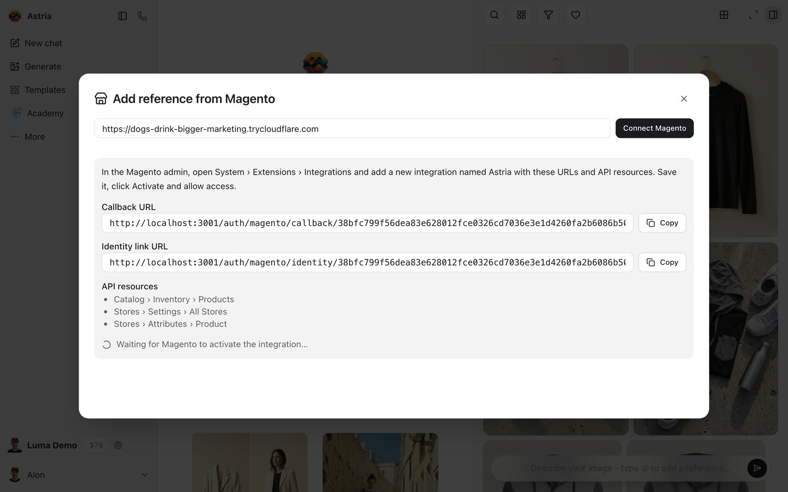

The links are valid for one hour.

### 3. Add an integration in Magento

In the Magento admin, go to **System › Extensions › Integrations** and click **Add New Integration**.

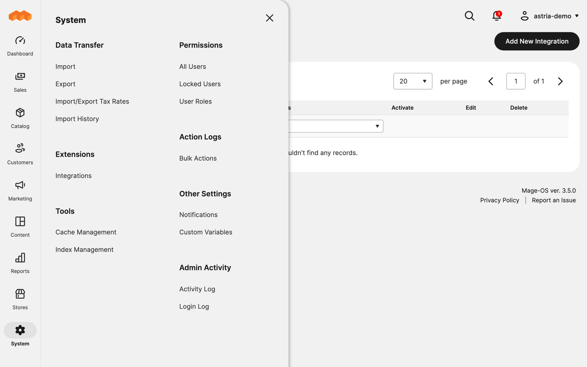

- **Name:** `Astria`
- **Callback URL:** paste the Callback URL from Astria.
- **Identity link URL:** paste the Identity link URL from Astria.
- **Your Password:** your Magento admin password.

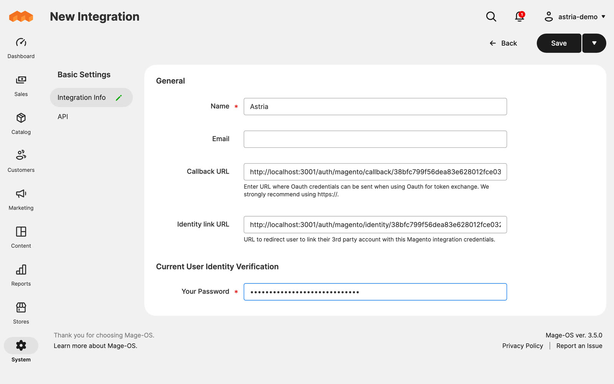

### 4. Grant three permissions

Open the **API** tab and set **Resource Access** to **Custom**. Tick:

| Resource | Why Astria needs it |
| --- | --- |
| Catalog › Inventory › **Products** | Read products and variants, and upload images to their galleries |
| Stores › Settings › **All Stores** | Find your store's links and media URLs |
| Stores › Attributes › **Product** | Show option names such as "Black" and "XL" |

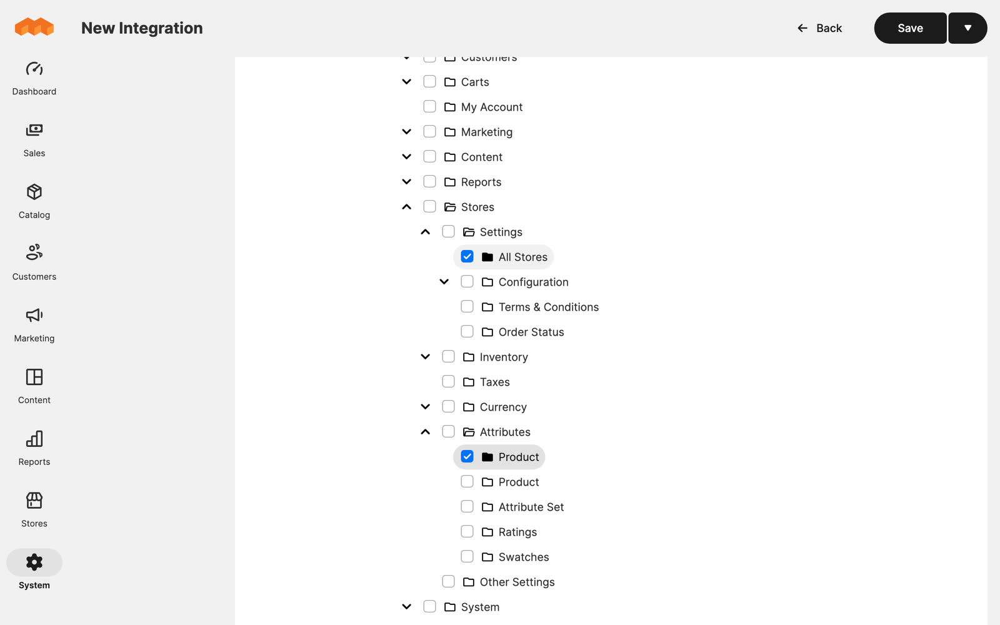

### 5. Save, Activate, Allow

Click **Save**. In the integrations list, click **Activate** next to Astria, then **Allow**.

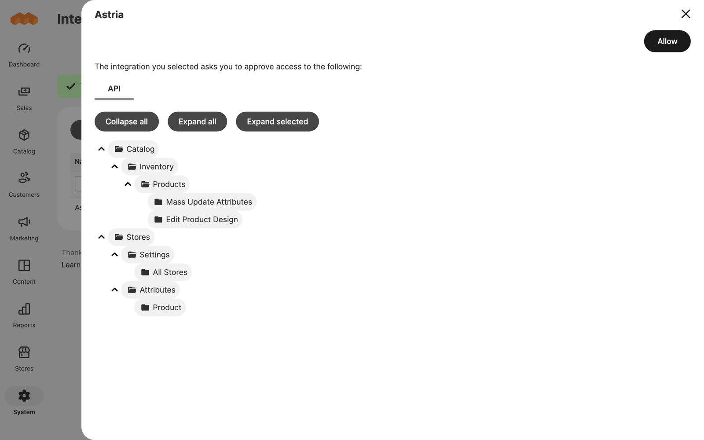

A small Astria window opens and closes by itself. The integration's status changes to **Active**, and Astria shows your catalog.

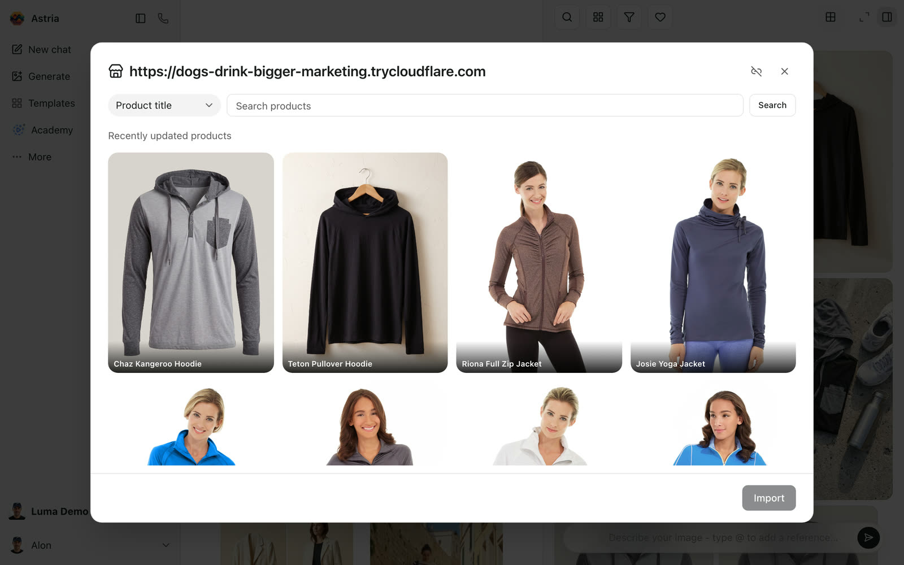

:::tip Reconnecting
To connect again later, for example after moving to a new domain, start a new connection in Astria and paste the new links into the same Magento integration. Avoid Magento's **Reauthorize** button: it replaces the access token, and the current Astria connection stops working.
:::

## Import products as references

Open **Connectors › Manage connectors** and click **Browse** next to Magento, or pick **Magento** in the reference picker. Search by product title, SKU, product ID or product URL, select products and click **Import**.

- A product with several colors becomes **one reference per color**. Each reference keeps the product photos of its color.
- Sizes need no reference of their own. A color's reference covers all of its sizes.
- Each reference remembers which Magento product and variants it came from, so uploads find their way back without any matching.

## Upload generated images

Select images in your gallery and click **Magento** in the selection bar. You can also upload a single image from its menu with **Upload to store**.

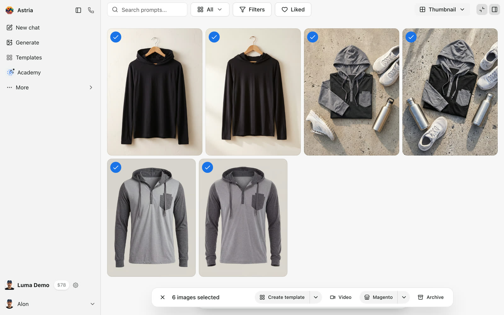

The upload dialog groups the images by the reference they were made with. Each group has a destination product, the images to upload and the variants they go to.

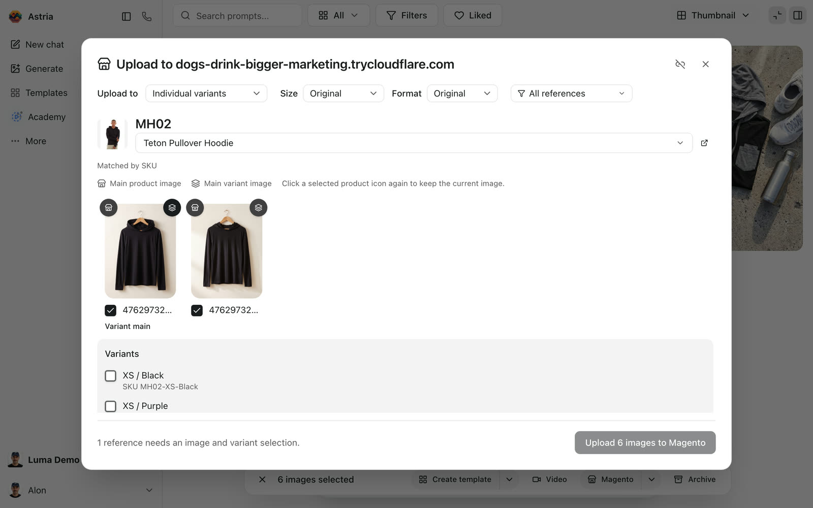

Check each group, then click **Upload … to Magento**. You can close the window while it runs. The upload log lists each image and the product it went to, with a link to open the product.

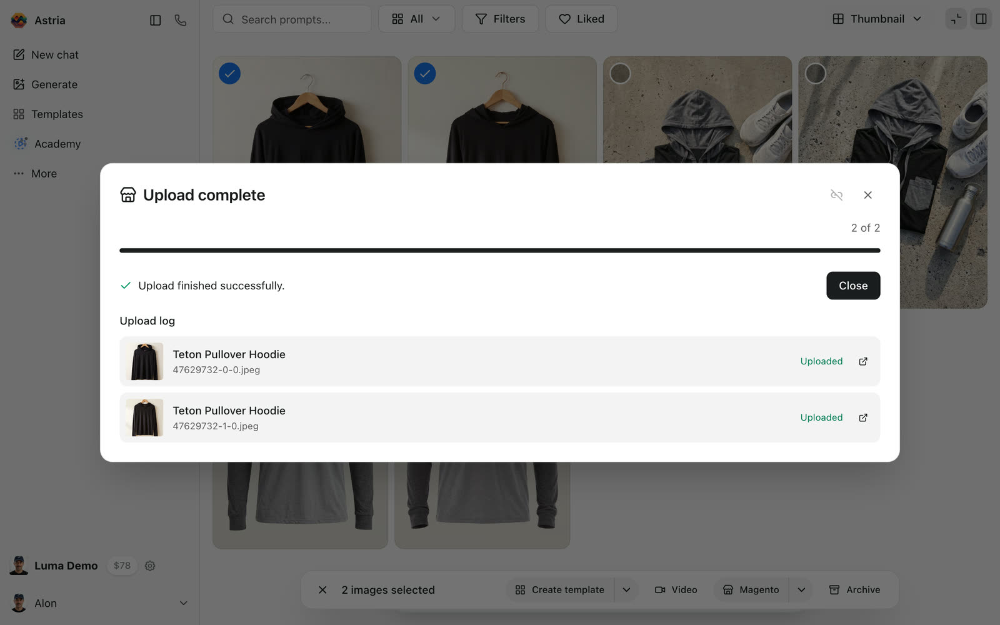

### How images are matched to products

Astria fills in each group's product in this order:

1. **Saved destination.** The reference was imported from Magento, or you uploaded its images before. Astria reuses that product and the same variants.
2. **Matched by SKU.** The reference's name is a SKU, or its image file names contain one. Astria looks up SKUs in your store:

   | The SKU found is… | Images go to |
   | --- | --- |
   | A product's SKU, e.g. `MH02` | That product |
   | One variant's SKU, e.g. `MH02-XS-Black` | That variant |
   | A product SKU plus a color code, e.g. `HD100BLK` when the variants are `HD100BLKS`, `HD100BLKM`… | All sizes of that color |

3. **No match.** Choose the product yourself.

Matches are only suggestions until you upload. After an upload, the reference remembers the destination you chose. If you pick **No product — skip**, Astria stops suggesting a product for that reference.

### Search for a product

Click the product name to change it. Search by **Name**, or switch to **SKU** and type an exact SKU. A variant's SKU finds its parent product.

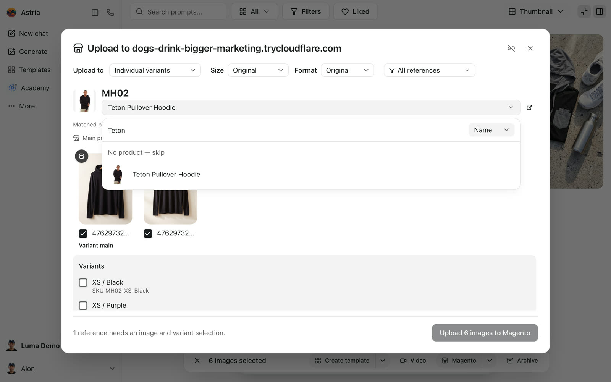

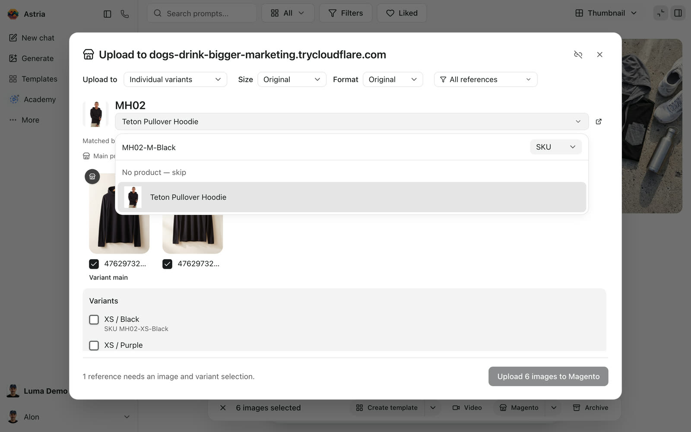

### Colors and variants

Use **Upload to** at the top of the dialog to choose where images go:

| Upload to | Images go to |
| --- | --- |
| **Product gallery** | The main product's gallery only |
| **By colour · all sizes** | Every size of the colors you tick |
| **Individual variants** | The exact variants you tick |

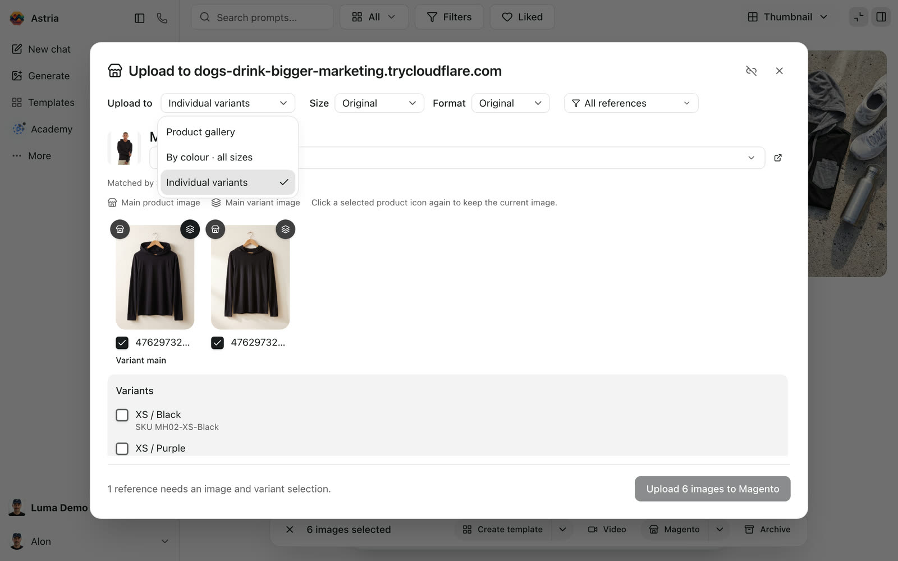

**Individual variants** works with any SKU format. References imported from Magento already have their color's variants ticked. For example, the Black reference ticks XS to XL in Black.

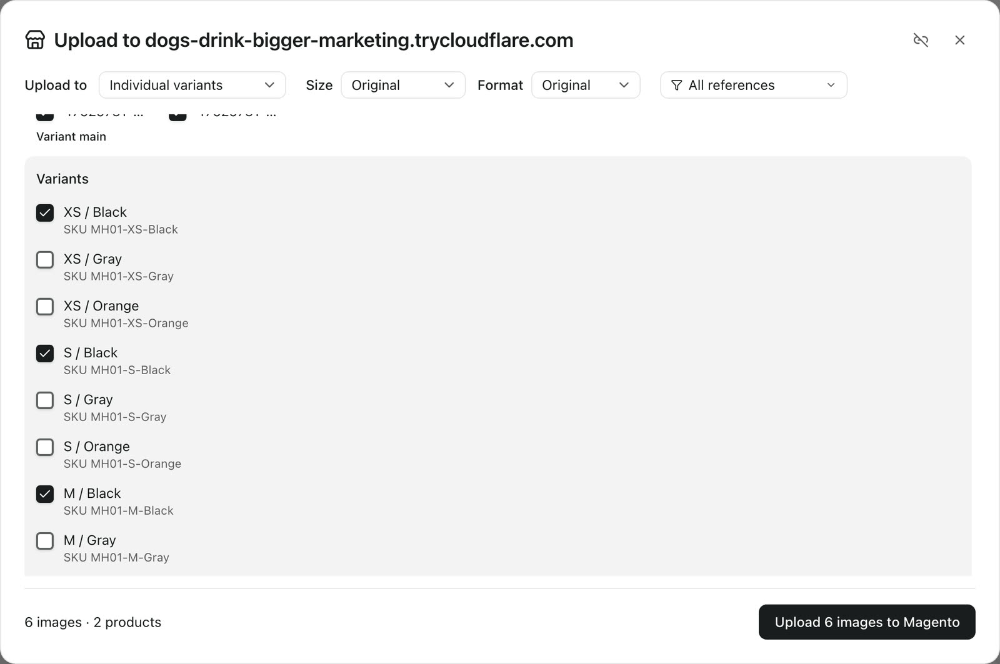

**By colour · all sizes** groups variants by their SKU. It expects each variant SKU to be the product SKU, then a color code, then a size code at the end, such as `HD100-BLK-XS`. Under **Advanced: SKU matching**, set how many characters the color code and the size code take, separators included (`-BLK` is 4, `-XS` is 3). If your SKUs put the size before the color, like Magento's sample `MH02-XS-Black`, use **Individual variants**.

Magento can't share one gallery image between products, so each ticked variant gets its own copy of the image.

### Main product image and main variant image

Each image has two buttons:

- <b>Store icon: main product image.</b> The image also goes to the main product and becomes the image shoppers see first on the product page and in listings.
- <b>Layers icon: main variant image.</b> The image becomes the main image of every ticked variant, so it shows when a shopper picks that color. The first image is selected by default.

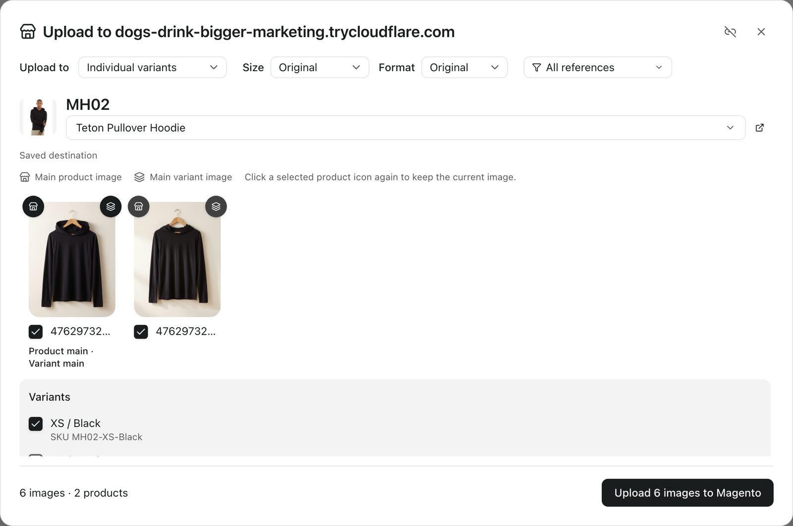

The main image gets Magento's **Base**, **Small** and **Thumbnail** roles. The other images are added to the gallery without roles, after the main image. Existing images stay in the gallery. Click a selected store icon again to keep the product's current main image.

With **Product gallery**, an image gets the image roles only if the gallery was empty.

In the Magento admin, the generated packshot is now the hoodie's main image, with the Base, Small and Thumbnail roles:

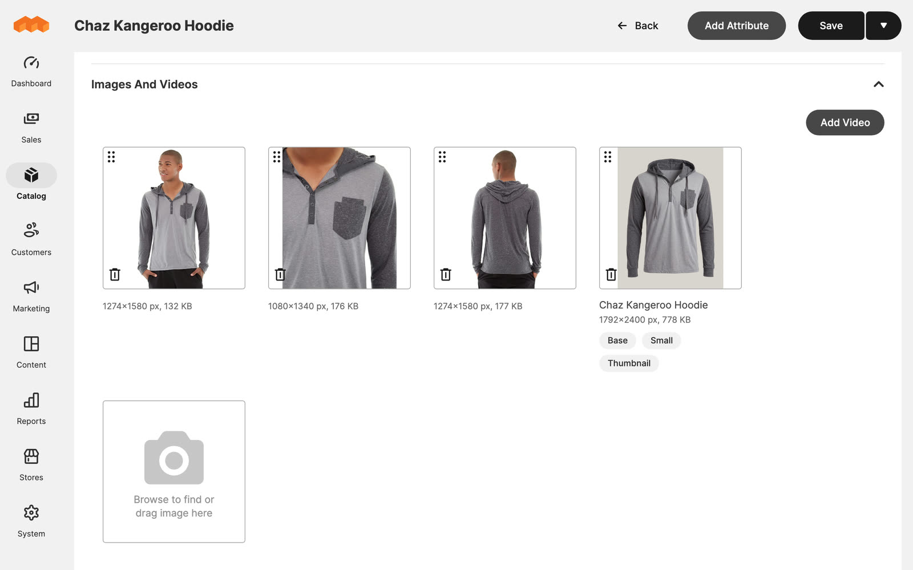

On the storefront, each color swatch shows the image uploaded for that color:

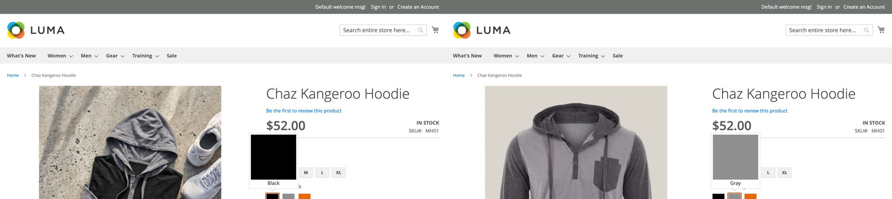

## Good to know

- **Formats.** Magento accepts JPEG and PNG uploads. With **Format: Original**, Astria converts WebP and AVIF images to JPEG.
- **Large images.** Magento receives images inside the API request. If large uploads fail, ask your host to raise PHP's `post_max_size` to at least 1.5× your largest image.
- **Retries are safe.** If an upload is interrupted, uploading again does not create duplicates.
- **"The consumer isn't authorized to access…"** means one of the three permissions is missing. Edit the integration in Magento, tick it on the **API** tab and save. The connection stays in place.
- **Store views.** Images are uploaded at the global level (all store views), never as store-view overrides.
