import connectVideo from './img/shopify/connect-shopify.mp4';
import connectPoster from './img/shopify/connect-poster.jpg';

# Shopify

Connect your Shopify store to Astria to:

1. **Import products** as references, with all their variants and photos.
2. **Generate** product photos and lookbooks with those references.
3. **Upload** the images you like back to the product. Each image is added to the product's gallery, and you can make one of them the image of the variants you pick, such as every size of one color.

**Before you start**

- You need to be able to sign in to the store's Shopify admin and approve apps for it.
- In Astria, you need to be the owner of the workspace you connect the store to. Other members of the workspace can then import products and upload images.
- A workspace connects to one Shopify store at a time.

## Connect your store

<video width="100%" controls muted playsInline preload="metadata" src={connectVideo} poster={connectPoster}></video>

### 1. Open Connectors in Astria

Below the chat box, open **Connectors › Manage connectors** and click **Connect** next to **Shopify**.

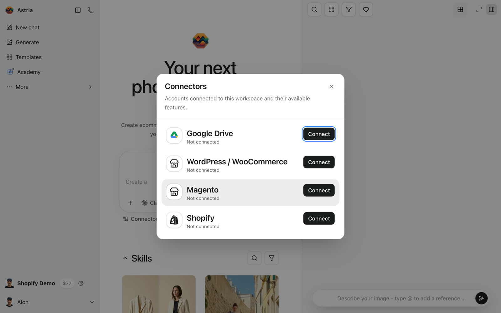

### 2. Continue with Shopify

Click **Continue with Shopify**.

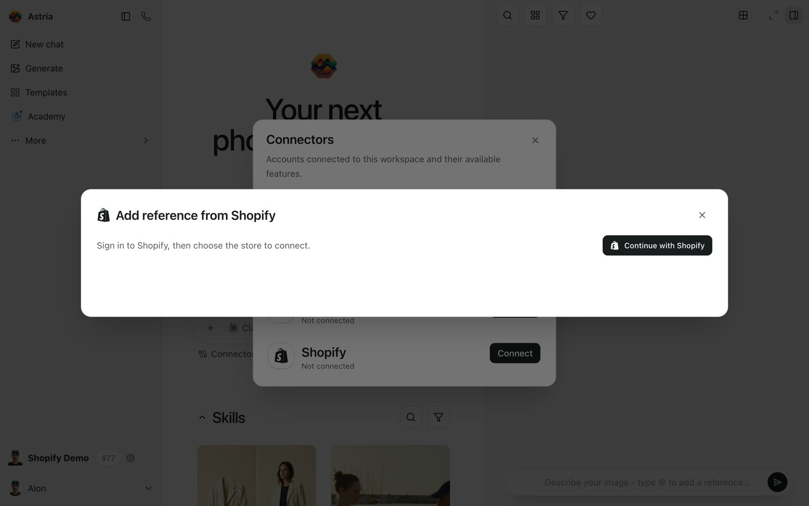

### 3. Approve Astria in Shopify

Shopify opens in the same window:

- Sign in, if you aren't signed in already.
- If your account has more than one store, choose the store to connect.
- The first time, approve the app. Astria asks for access to **products** and **files**. It needs them to read your catalog and to add images to product galleries.

If you're already signed in and the app is already approved, Shopify skips these screens and sends you straight back.

### 4. Back in Astria

Astria confirms **Connected *your-store*.myshopify.com**. In **Connectors**, Shopify now shows your store, with a **Browse** button.

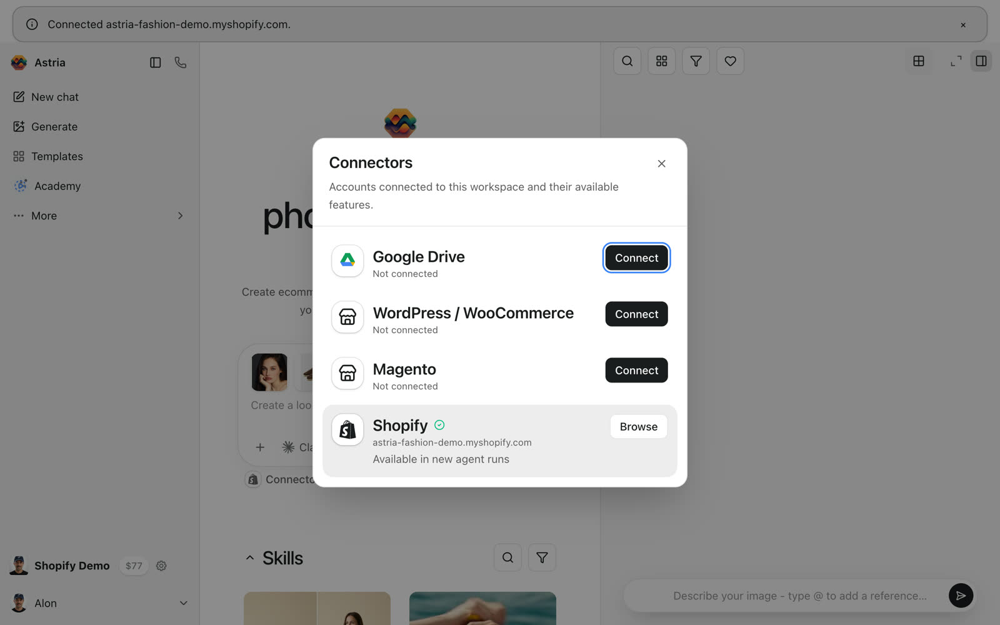

:::tip Disconnecting
To disconnect, click **Browse** next to Shopify in **Connectors › Manage connectors**, then click the disconnect icon at the top of the window. This removes the store from the current workspace only. If you uninstall the Astria app in Shopify, the store is disconnected from every Astria workspace.
:::

## Import products as references

Open **Connectors › Manage connectors** and click **Browse** next to Shopify, or pick **Shopify** when you add a reference. Astria shows your 25 most recently updated products; click **Load more** to see more.

To find a specific product, search by:

| Search by | Type |
| --- | --- |
| **Product title** | The product's full title |
| **Exact SKU** | A variant's SKU, exactly as in Shopify |
| **Product ID** / **Variant ID** | The number from the Shopify admin |
| **Shopify URL** | A product link on your `.myshopify.com` address, or the product page in the Shopify admin |

Click products to select them (Shift-click selects a range), then click **Import**.

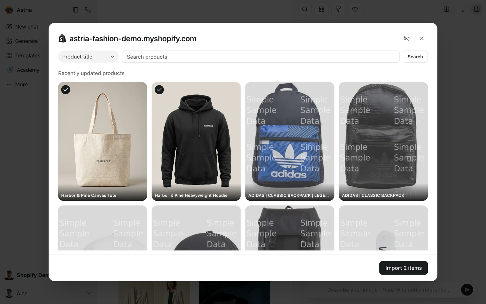

- Each product becomes **one reference**, named after the product. It includes all the product's photos and covers all its variants, every color and size.
- Astria detects what the product is (for example "hoodie" or "bag") and describes each photo for you.
- Importing the same product again reuses its reference instead of creating a second one.
- Each reference remembers which Shopify product it came from, so its images find their way back when you upload.

## Upload generated images

Select images in your gallery and click **Shopify** in the selection bar. You can also upload a single image from its menu with **Upload to store**.

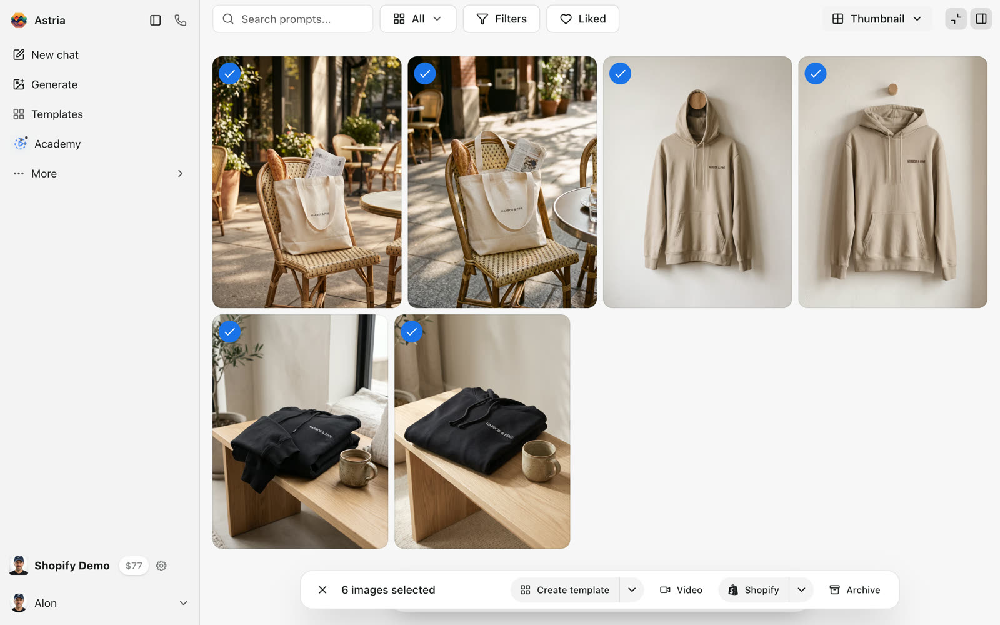

The upload window groups the images by the reference they were made with. Each group shows the product its images go to. Click the image stack on the right to review the images and untick any you don't want to upload.

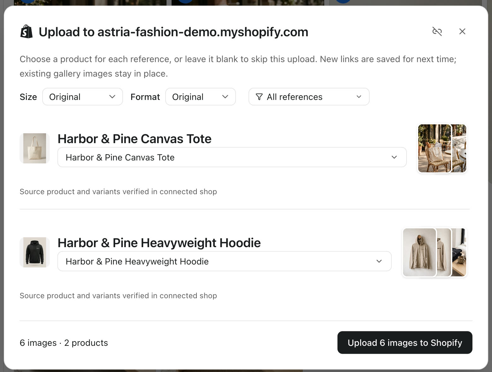

At the top you can also choose:

- **Size** and **Format** (Original, JPG or WebP).
- Which references to show. Only the references you show are uploaded.

Click **Upload … to Shopify**. You can close the window while the upload runs; it continues in the background. If an image fails, click **Retry failed images**.

### How images are matched to products

Shopify uploads use the link between a reference and a Shopify product. A reference has a link when:

- It was **imported** from Shopify.
- You **chose a product** for it in an earlier upload. New links are saved for next time.
- It was created by a **store photoshoot** from your Shopify store's public pages. Astria links these to the product after you connect the store.

Before suggesting a product, Astria checks that the product and its variants still exist in the connected store. This shows as **Source product and variants verified in connected shop**. A product that was deleted, or that belongs to another store, isn't suggested.

Astria doesn't guess Shopify products from SKUs or titles. A reference without a link starts at **No product — skip**: choose the product yourself, or leave it to skip that reference's images in this upload.

To see or change a reference's link without uploading, open the reference and use **Product mappings › Shopify mappings**.

### Search for a product

Click the product name to change it. The list starts with your most recently updated products. To search, type the product's **full title**, or switch **Name** to **SKU** and type an exact SKU. A variant's SKU finds its product.

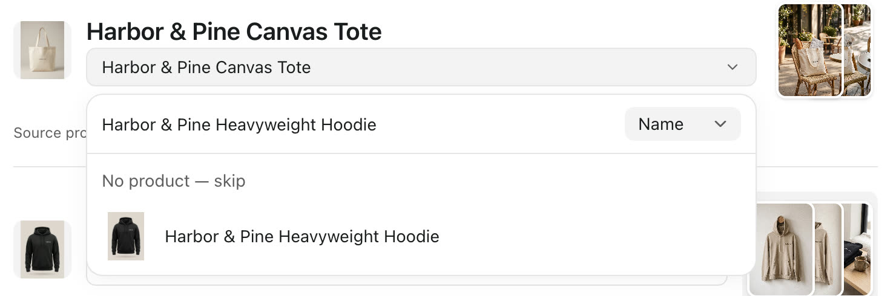

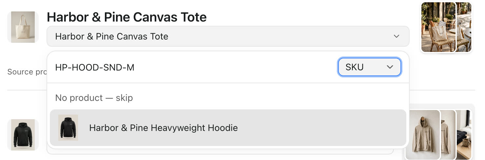

### Product gallery and variant images

In Shopify, the colors and sizes of a product are its variants. They share one product gallery, and each variant shows one image from that gallery. Uploads follow the same model:

- **Every image goes to the product gallery.** Uploaded images are added after the images that are already there. Existing images stay in place.
- **The main product image doesn't change.** Shopify shows the first gallery image as the product's main image, and Astria doesn't reorder the gallery. To make an uploaded image the main image, drag it to the front in the Shopify admin. If the gallery was empty, the first uploaded image becomes the main image.
- **Variant images change only if you ask.** By default, every variant keeps its current image.

To set a variant image, review the group's images and click **Variant image (optional)**. Choose one of the images, then tick the variants that should show it. All the product's variants are ticked at first, or the ones you ticked last time for this reference.

For example, to show a new sand-colored photo when a shopper picks Sand, tick the three Sand sizes and untick Black:

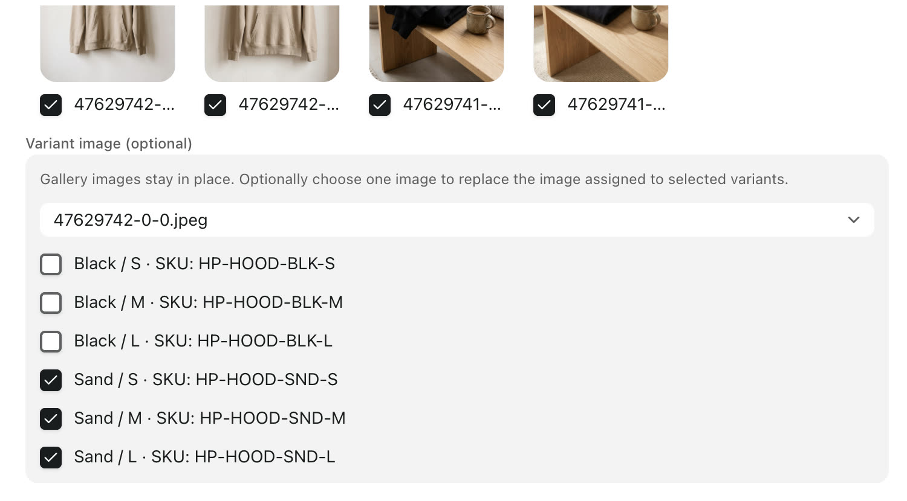

- Each group sets one variant image. To give each color its own image, upload in two rounds: select the Sand images and tick the Sand variants, then select the Black images and tick the Black variants.
- Astria saves the variants you tick with the reference's link, so they're ticked again the next time you upload its images.
- A variant can get only one image per upload. If two groups give the same variant different images, Astria asks you to choose one.

After the upload, the hoodie's gallery in the Shopify admin has its original four packshots first, followed by the four generated photos:

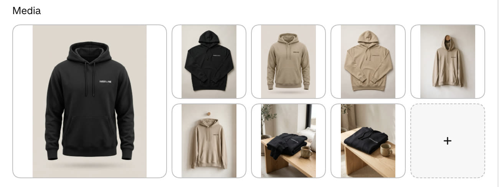

The Sand variants now show the uploaded photo. The Black variants keep their packshot:

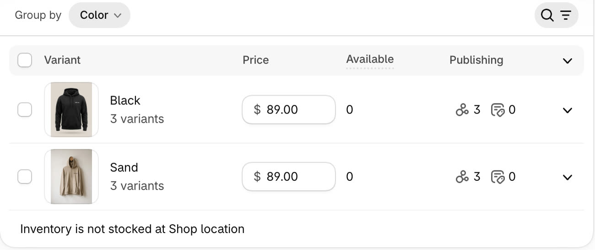

## Good to know

- **Formats and size.** JPEG, PNG and WebP images upload as they are. Other formats are converted to JPEG, and so are images from workspaces that watermark their downloads. Shopify accepts images up to 20 MB and 20 megapixels; choose a smaller **Size** if an image is larger.
- **Shopify Files.** Uploaded images also appear in **Content › Files** in the Shopify admin, with names that start with `astria-`.
- **Retries are safe.** If an upload is interrupted, uploading again or clicking **Retry failed images** doesn't create duplicates.
- **"Shopify authorization expired. Please reconnect."** Connect the store again from **Connectors**. Your references keep their product links.
